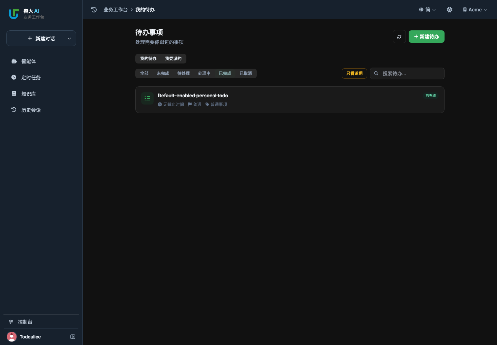

# 待办默认启用 Web 验收

- 交付基线：`da41ea8df16bce9b6f07b7afe11d3f7f80923163`（rdai）。
- 用户要求：待办自动开启，不要求人工配置开关；仅验证 Web，共享后端同步验证，Desktop 测试继续停止。
- 原因：配置声明、模板与服务缺省值均为关闭，现有 localhost 配置未包含该键，因此列表返回关闭状态。
- 实现：三处默认值统一为开启；已有显式 false 继续作为部署关闭选项，读取配置失败继续拒绝，用户/租户/权限与可信工具调用规则不变。当前实例仅需加载新代码，不改写其配置或业务数据。
- 回归复现：测试不再把待办强制开启，未修复时 `test_database_list_and_summary_use_private_store` 实际得到 404 / 功能未开启；修改缺省值后通过。
- 定向验证：`tests/test_todo_web_database.py`、`tests/test_todo_service.py`、`tests/test_todo_tool_identity.py`、`tests/test_todo_delegation_permissions.py`、`tests/test_todo_private_state.py` 共 70 项通过，包括显式关闭、匿名拒绝、真实身份、用户/租户隔离及存储保护。
- 浏览器新增无开关配置的普通成员用例：真实登录、新建表单、刷新恢复、第二个成员列表与直接读取拒绝、确认完成并刷新查看完成状态。初次脚本未接受既有完成确认框导致等待超时，补充真实对话框确认后复验；未改产品确认逻辑。
- 原有历史会话自动收起仅给出方案，本次不改变导航行为。

最终必需 Web 门禁通过：

```sh
NODE_PATH=tests/browser/node_modules UPSTREAM_SYNC_BASE_SHA=da41ea8df16bce9b6f07b7afe11d3f7f80923163 .venv/bin/python scripts/check-upstream-sync.py --output .sync-test/todo-required
```

- 46 个实际浏览器场景通过，无页面错误或未预期路由；新增待办场景纳入必需清单，8 个真实待办接口测试亦纳入清单。
- 候选摘要 `6172120a5d4e8eae8e4b76b1748aede3c9d1ca4e8fd57fe2fd647a89e2475b28`，验证前后相同；各检查层均通过，详见 [门禁结果](results/todo-default-enabled/required-report.json) 和 [浏览器结果](results/todo-default-enabled/browser-results.json)。
- OpenSpec strict、delta 基线及 todo-management 活动 change 重叠检查通过。
- localhost:9899 已重启；用当前已登录账号的独立 Chrome 页核验，关闭提示消失，已有待办正常显示。仅观察真实数据，未新增或修改业务事项；无须改写用户配置。
- 下图来自隔离测试账号，展示表单创建、确认完成和刷新后的状态，不包含真实业务数据。



远端 CI 和最终合并提交以本次 PR 的准确提交记录为准；桌面四项仍停止，change 不归档。
